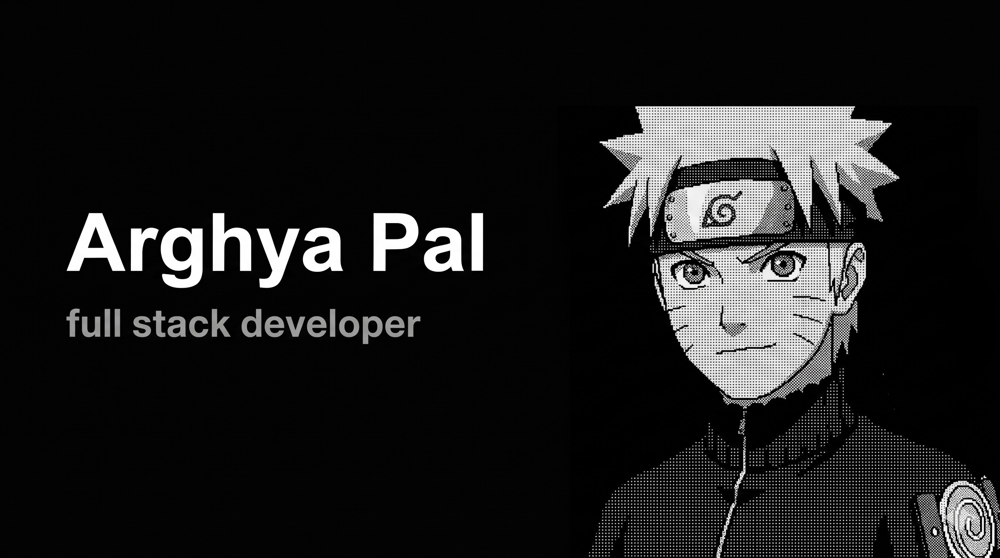

# Arghya's Portfolio

[](https://) – A personal portfolio to showcase my work and projects s as a Full Stack Developer.

---

## Screenshot
  

---

## Overview

This is a minimal, modern, and responsive portfolio. It includes:

- Portfolio showcase


---

## Live Site

Check it out: [](https://)

---

## Tech Stack

- **Framework:** Next.js 15 + TypeScript  
- **Styling:** Tailwind CSS v4  
- **Deployment:** Vercel  
- **Icons:** Lucide  
- **Animations:** Framer Motion  

---

## Features

- **Clean & Modern Design** 
- **SEO Optimized** 
- **PWA Ready** 
- **Dynamic OG Images**: For rich social previews  
- **Component Registry**: Easily showcase and document reusable components  

---

## Development

To run locally:

```bash
# Clone the repo
git clone https://github.com/ArghyaPal-07/arghya-portfolio.git
cd arghya-portfolio

# Install dependencies
npm install   


# Run development server
npm run dev  
